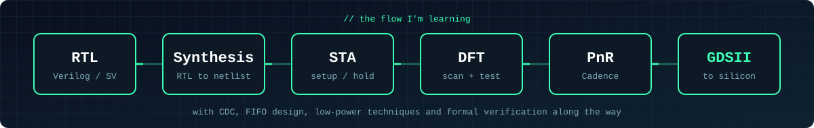

<div align="center">



<a href="https://github.com/denvercoder1/readme-typing-svg">
  
</a>

<br/>


</div>

---

## 👋 About me

Third-year Electrical Engineering student at **McMaster University**, building toward a career in **ASIC/FPGA design and digital hardware**. I like the whole path a design takes, from a blank Verilog file to a placed and routed chip.

```verilog
module aymaan (
    input  wire clk,
    input  wire rst_n,
    output reg  [7:0] learning
);
    // always be shipping
    always @(posedge clk or negedge rst_n) begin
        if (!rst_n) learning <= 8'd0;
        else        learning <= learning + 1'b1;
    end
endmodule
```

<br/>

## 🧭 The flow I'm working through



<br/>

## 🔬 What I'm into

| | |
|---|---|
| 🧩 **RTL Design** | Verilog and SystemVerilog |
| ⚙️ **Logic Synthesis** | RTL to gate-level netlist |
| ⏱️ **Static Timing Analysis** | Finding and fixing timing problems |
| 🔀 **CDC and FIFO Design** | Moving data safely between clocks |
| 🧪 **Design for Test** | Making chips testable |
| 🔋 **Low-Power VLSI** | Spending fewer picojoules |
| 🗺️ **Physical Design** | Place-and-route |

<br/>

## 📚 Currently learning

```text
[##########] Verilog / SystemVerilog, from syntax to complex systems
[########--] TCL scripting for design constraints
[########--] Timing analysis: STA concepts, analysis and fixes
[#######---] Low-power VLSI design fundamentals
[#######---] Logic synthesis: RTL to gate-level netlist
[######----] CDC and FIFO design
[#####-----] Design for Test (DFT)
[####------] Formal verification (Synopsys Formality flow)
[####------] Physical design with Cadence (PnR)
```

<br/>

## 💼 Experience

| Role | Where |
|---|---|
| 🔧 Reliability & Maintenance Engineering Intern | **Sofina Foods** |
| 🎓 B.Eng. Electrical Engineering | **McMaster University** |

<br/>

<!--
OPTIONAL: GitHub stats. Swap YOUR_USERNAME for your GitHub username, then delete this comment wrapper.

<div align="center">
  
  
</div>
-->

<div align="center">


</div>
